# Cidade Estrutural

**Uma cidade 3D onde cada obra se abre em corte e mostra, passo a passo, como a estrutura é construída e por que ela funciona.**

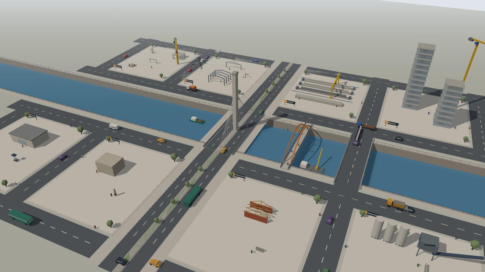

Fôrmas, armaduras, concretagem, protensão, içamento e estais são animados em tempo real. Ao lado aparecem os esforços, as tensões, as fissuras e as flechas, todos calculados em código. É engenharia estrutural de verdade, explicada para quem está aprendendo, e roda direto no navegador, sem instalar nada.

---

## Destaques

- **Vista em corte animada.** Cada obra se abre ao meio e mostra o que normalmente fica escondido: barras de aço, cordoalhas, camadas do leito do rio, mapa de tensões no concreto.
- **Números que concordam com a imagem.** Diagramas, legendas e textos saem das mesmas funções de cálculo (NBR 6118 simplificada), testadas automaticamente (32 testes).
- **Uma cidade viva.** Trânsito, pedestres, barcos, gruas e operários trabalhando. A logística liga as obras: a betoneira sai da central e cruza a ponte até a viga; a van leva os corpos de prova para o laboratório; a carreta leva a viga pré-moldada até a ponte.
- **Obras conectadas.** A viga leva ao ensaio do seu concreto e do seu aço; a viga protendida do pátio é a mesma que o guindaste coloca na ponte.
- **Para assistir ou explorar.** Tour guiado, linha do tempo arrastável, pausa e velocidade, tema claro e escuro, e funciona no celular.
- **Arquivo único.** Um `.html` de ~630 KB que abre com duplo clique, sem servidor e sem internet.

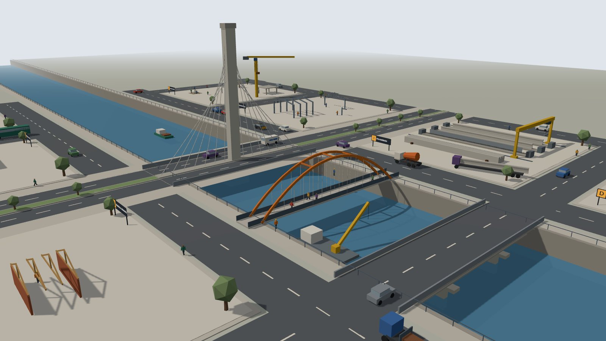

---

## As obras

| | |
|---|---|
| 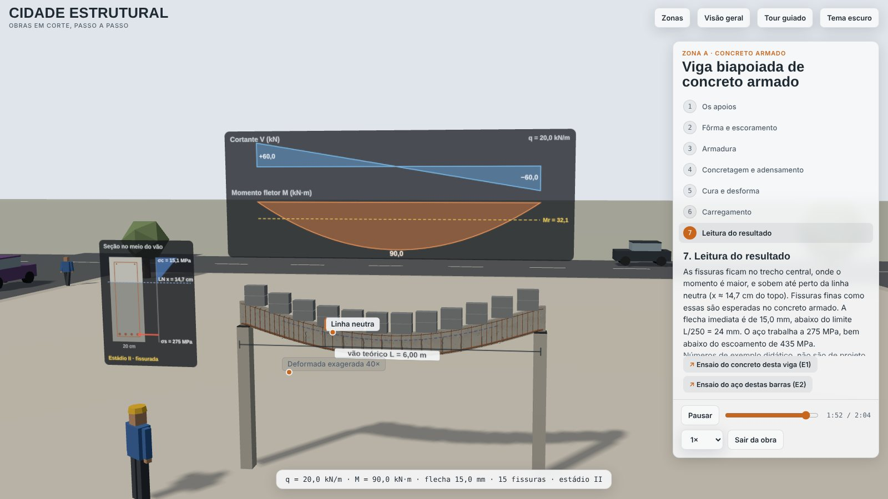 | **A1 · Viga biapoiada de concreto armado**<br>Fôrma, armadura, concretagem e cura; depois a carga cresce, os diagramas de cortante e de momento aparecem, a viga fissura onde o momento é máximo e a flecha é comparada com L/250. |
| 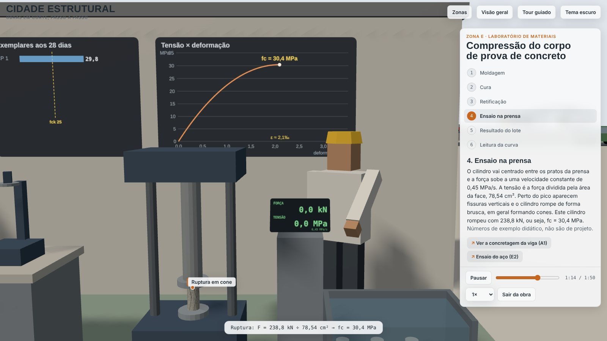 | **E1 · Compressão do corpo de prova**<br>Moldagem, cura e retificação; o cilindro vai para a prensa, rompe em cone e entra na estatística do lote (fck estimado). |
| 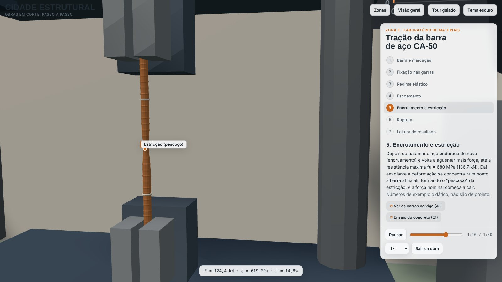 | **E2 · Tração da barra CA-50**<br>Regime elástico, patamar de escoamento, encruamento e estricção (o "pescoço") até a ruptura, com a verificação da NBR 7480. |
| 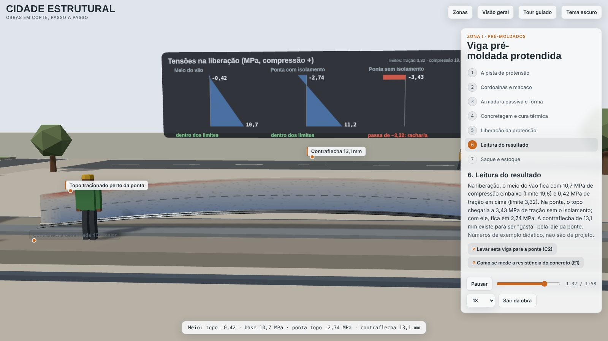 | **I1 · Viga pré-moldada protendida**<br>Cordoalhas tensionadas uma a uma, cura térmica e liberação: a face cortada vira um mapa de tensões e a viga ganha contraflecha. |
| 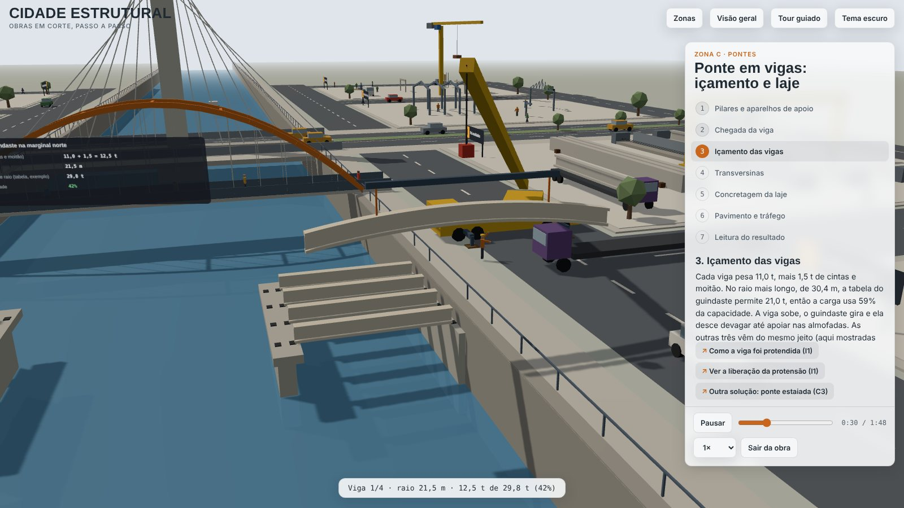 | **C2 · Ponte em vigas: içamento e laje**<br>O guindaste coloca as quatro vigas sobre os aparelhos de neoprene; a laje é concretada e a contraflecha quase zera. |
| 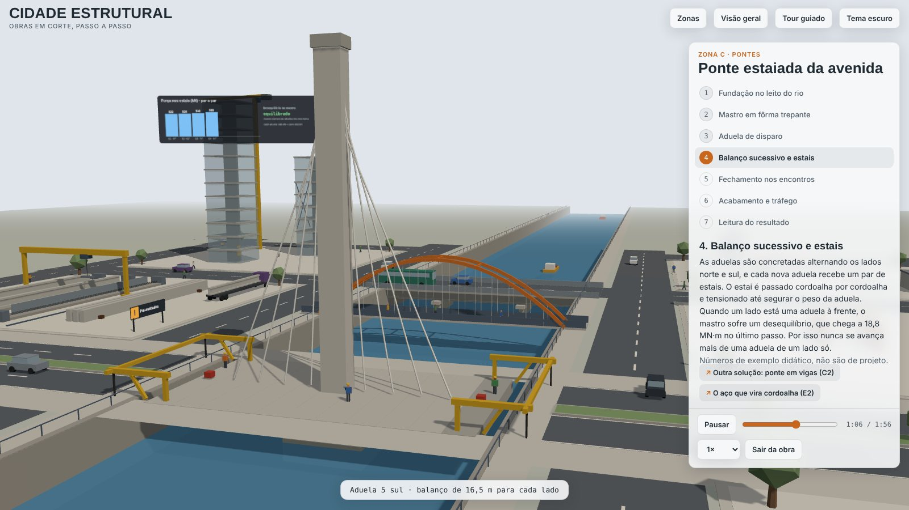 | **C3 · Ponte estaiada da avenida**<br>Estacas no leito, mastro em fôrma trepante e balanço sucessivo: aduelas alternadas e estais tensionados par a par, com o desequilíbrio do mastro em tempo real. |

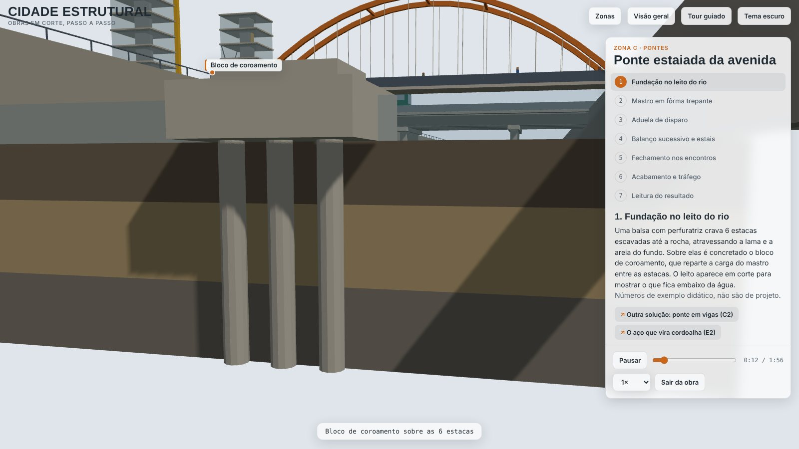

---

## A cidade

| | |
|---|---|
| 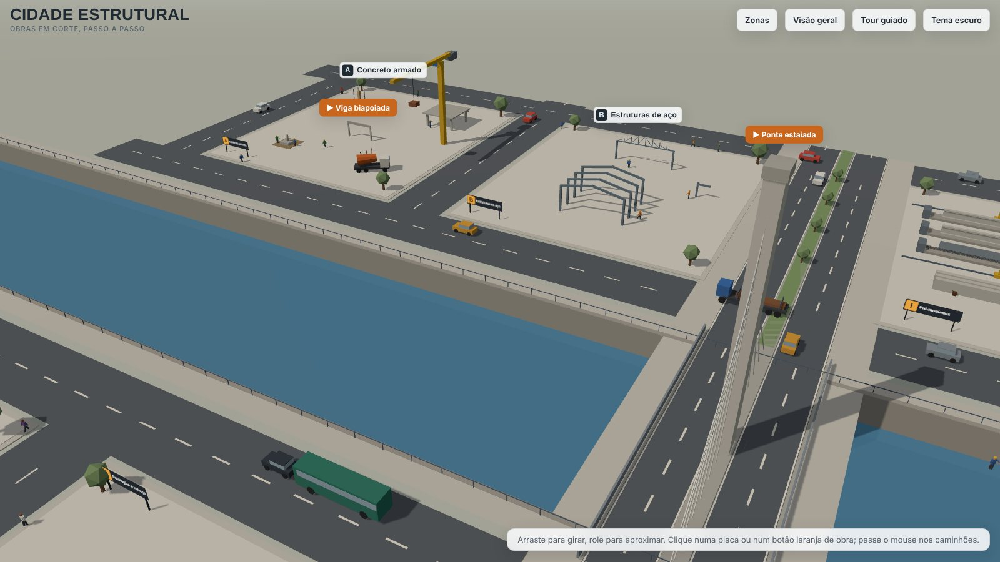 | **Cena limpa, informação sob demanda.** Placas discretas com a letra e o nome de cada zona. Passe o mouse num caminhão para ver o que ele leva e para onde vai; clique e a câmera passa a segui-lo. |
| 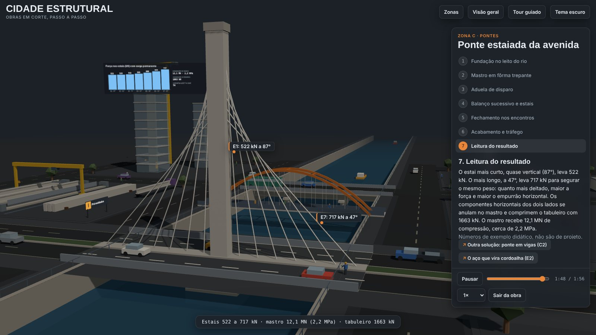 | **Tema claro e escuro**, com rótulos que acompanham a narração e só um destaque por vez. |

<p align="center">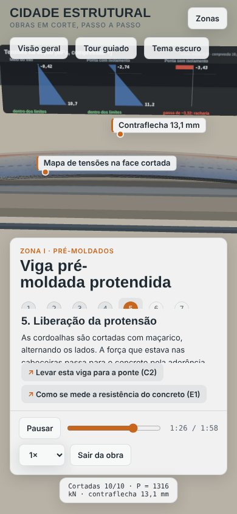</p>

**Zonas:** A Concreto armado · B Estruturas de aço · C Pontes (no rio) · D Edifícios altos · E Laboratório de materiais · F Patologias e reforço · G Madeira e alvenaria · H Central de concreto e aço · I Pré-moldados.

---

## Para quem

- **Cursos de engenharia civil e escolas técnicas:** aula de estruturas com o canteiro e o comportamento na mesma tela.
- **Construtoras e pré-moldadoras:** apresentar o método construtivo a clientes e equipes.
- **Feiras, museus e eventos:** tela grande em modo tour, que se repete sozinha.

---

## Como abrir

- **Arquivo único:** baixe `docs/app/index.html` e dê duplo clique. Para abrir direto numa obra, acrescente ao endereço `#viga`, `#compressao`, `#tracao`, `#protensao`, `#icamento` ou `#estaiada`.
- **No GitHub Pages:** em *Settings → Pages*, escolha *Deploy from a branch → main → /docs*. O endereço `https://<usuário>.github.io/cidade-estrutural/` abre o app direto (não precisa de GitHub Actions: o arquivo já vem pronto em `docs/app`).
- **Controles:** arraste para girar, role para aproximar, espaço pausa, Esc sai da obra.

## Para desenvolver

```bash
npm install
npm run dev        # servidor local
npm test           # 32 testes dos cálculos e da malha viária (node --test)
npm run artifact   # gera dist/cidade-estrutural.html e docs/app/index.html
node scripts/prints.mjs   # refaz as imagens de docs/img
```

Tecnologia: Three.js 0.170, Vite 5 e JavaScript puro, sem framework. Cálculos e malha viária em módulos puros (`src/calc`, `src/core/malha.js`); uma obra por arquivo em `src/zones`.

Planejamento, decisões, valores adotados e pendências: [`docs/ROADMAP.md`](docs/ROADMAP.md).

> Os números das obras são exemplos didáticos, não são de projeto.
